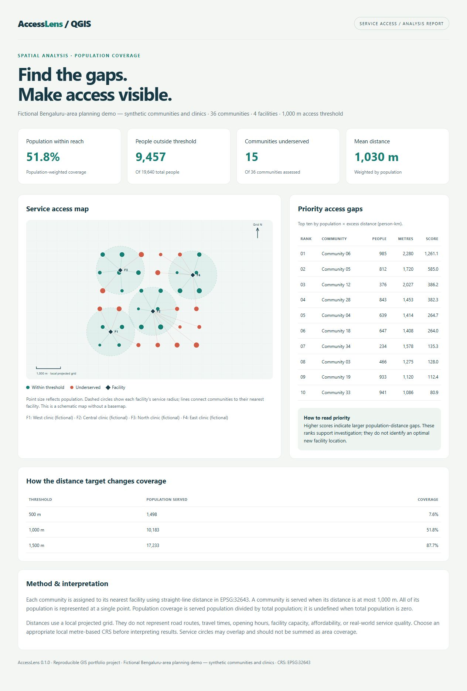

# AccessLens

**A QGIS plugin for finding population-weighted gaps in public-service access.**

Use community population points and service locations to see who falls outside a chosen straight-line distance threshold. Built as an understandable, reproducible GIS portfolio project with Python, PyQGIS, spatial indexing, CRS transformations, and a Processing provider.



## Try it

1. Use **QGIS 3.44 LTR**. This release targets QGIS 3.x; QGIS 4 compatibility is not declared.
2. Open **Plugins → Manage and Install Plugins → Install from ZIP**.
3. Download `accesslens-0.1.0.zip` from the [v0.1.0 release](https://github.com/Mariyaben/AccessLens/releases/tag/v0.1.0), select it, and enable **AccessLens**. To build from source instead, run `python tools/package.py` and select the ZIP in `dist/`.
4. Select **Plugins → AccessLens → Load fictional AccessLens demo**.
5. Explore the layers and the report that opens in your browser. The demo adds a layer group to the current project.

The included **[sample report](demo/access-report.html)** opens in a normal browser without QGIS, an API key, internet access, or a separate server. Its 36 communities, four clinics, and population figures are fictional. The locations are near Bengaluru solely to demonstrate a sensible local projection.

## What the plugin delivers

- A Processing algorithm: `accesslens:analyze_access`, available in the toolbox, batch interface, models, and Python console.
- Community points with nearest facility, distance, population, service status, priority score, and gap rank.
- Connection lines from each community to its nearest facility.
- Facility service-radius polygons, retaining overlaps.
- An optional self-contained HTML report with an SVG map, population coverage, highest-priority gaps, and threshold scenarios.
- A one-click styled demo and a reproducible reference CSV.

## Use your own data

Open the toolbar action or **Processing Toolbox → AccessLens → Service planning → Analyze service access gaps**.

| Input | Requirement |
| --- | --- |
| Community points | One valid point per community; source CRS must be set |
| Population | Numeric, finite, nonnegative population per point; no nulls |
| Service points | One valid point per clinic, school, water point, etc. |
| Labels | Optional fields for readable names |
| Threshold | Positive distance in metres |
| Analysis CRS | Choose an appropriate local projected CRS with metre units |
| Output locations | Save results to GeoPackage for a persistent portfolio project |
| Report | Optional HTML file and a subtitle identifying your data source |

For the Bengaluru demo, use `EPSG:32643` (WGS 84 / UTM zone 43N). This is not a global default: choose the right local projection for your study area. Angular, foot-based, and EPSG:3857 output CRSs are rejected. Extents over 200 km trigger a projection warning.

Invalid geometries, missing/negative populations, empty inputs, and write failures stop the run instead of quietly dropping records. Multipart points are rejected. Cancellation raises an error; discard any partially written spatial outputs. Inputs are read without editing them.

**Persist the demo:** the menu action produces temporary result layers. Export those layers to GeoPackage, then use **Project → Save As** to save a `.qgz` project. Saving the project alone does not embed temporary layer features.

## Method

1. Reproject both input layers to the selected metre-based CRS.
2. Build a `QgsSpatialIndex` R-tree of facility points and find each community's nearest facility.
3. Compute planar Euclidean distance and mark a community served when `distance <= threshold`.
4. Calculate population-weighted coverage and mean distance.
5. Rank gaps by `population × max(distance − threshold, 0) / 1000` in **person-km**. Larger gaps rank first; ties use distance, then source feature ID. Served communities have rank 0.

Zero total population produces undefined coverage/weighted mean, shown as `N/A`. Zero-population communities are still assessed geometrically. A nearest-facility tie has no effect on coverage or priority; the adapter chooses the lowest string ID among returned ties. Output IDs reference the input provider's feature IDs and are not stable external IDs after changing/exporting a source.

The calculation core is independent of QGIS and includes a brute-force nearest lookup for small-data reference checks. The QGIS adapter uses the spatial index. Features and results are held in memory; report size grows with the number of communities. Omit the report for large runs. No large-data performance benchmark is claimed.

This measures proximity. It does **not** estimate road travel time, allocate capacity, account for barriers, or optimize a new facility's location. Population is assumed concentrated at each community point. Overlapping service circles are not an estimate of total area coverage.

## Output fields

| Field | Meaning |
| --- | --- |
| `source_id`, `community` | Input feature ID and display label |
| `population` | Input population |
| `facility_id`, `facility` | Nearest facility's input feature ID and label |
| `distance_m` | Straight-line projected distance in metres |
| `served` | 1 if within threshold, otherwise 0 |
| `priority_pk` | Gap score in person-km |
| `gap_rank` | 1 = highest-priority gap; 0 = served |

Point and connection outputs share this schema. Radius polygons contain `facility_id`, `facility`, and `radius_m`. Original extra fields are not copied.

## Develop and verify

From this folder, using ordinary Python 3.9+:

```sh
python -m unittest discover -s tests -p "test_*.py" -v
python tools/package.py
```

To regenerate fictional GeoJSON coordinates and reference artifacts (build-time dependency only):

```sh
python -m pip install pyproj
python tools/build_demo.py
```

To exercise the real provider, reprojection, spatial outputs, validation and report writing, run with **QGIS's Python environment**:

```sh
python tests/qgis_integration.py
```

An ordinary Python install cannot import `qgis`. See [VALIDATION.md](docs/VALIDATION.md) for what was actually run and the QGIS manual acceptance checklist. Passing the calculation tests does not establish plugin installation or runtime compatibility.

## Portfolio materials

- [Resume bullets and interview talking points](docs/PORTFOLIO.md)
- [Two-minute demo walkthrough](docs/DEMO.md)
- [Architecture and design decisions](docs/ARCHITECTURE.md)
- [Sample results](demo/expected-summary.json) and [community CSV](demo/community-access.csv)

Source code and sample data are self-contained. The packaging command produces both the installable plugin ZIP and a complete source/demo ZIP.

## Release status and license

Version **0.1.0**, experimental portfolio implementation. Code: [GPL-3.0-or-later](accesslens/LICENSE). Synthetic data: [CC0 dedication](accesslens/data/README.md). No real public-health findings are claimed.

Maintained by [Mariya Benny](https://github.com/Mariyaben). QGIS runtime validation is pending. This package is not published in the official QGIS plugin repository.

## References

The integration follows the official [QGIS Processing plugin guide](https://docs.qgis.org/3.44/en/docs/pyqgis_developer_cookbook/processing.html), [Python plugin structure and metadata guide](https://docs.qgis.org/3.44/en/docs/pyqgis_developer_cookbook/plugins/plugins.html), and [QgsSpatialIndex API](https://api.qgis.org/api/3.44/classQgsSpatialIndex.html). Get the target application from the [official QGIS download page](https://www.qgis.org/download/).
